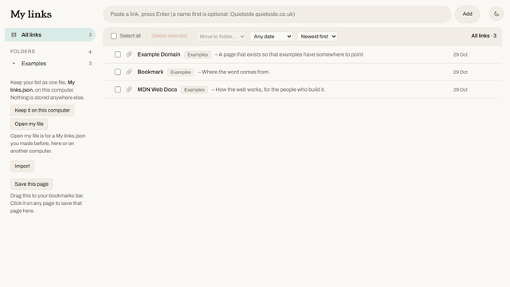

# My links

A plain bookmark page that keeps your links in one file on your own computer. Live at https://michalszyszka2-cmyk.github.io/my-links/

Folders sit on the left and links sit in rows on the right, like an inbox. Each link shows an icon, a name, a grey one-line description and the day it was added.

## How to use

1. Open the page. Until you choose a file it runs in try-it mode and keeps links in this browser only.
2. Click "Keep it on this computer" once and pick where to save `My links.json`.
3. Paste a link into the box at the top and press Enter.
4. Drag a link onto a folder to move it, or tick several to move or delete them together.
5. Filter by date, sort newest or oldest first, and switch between light and dark with the button top right.

## Where your links live

Your list is one file, `My links.json`, saved wherever you put it on your computer. The page writes to it through the browser's own file picker and remembers which file you chose. On a later visit the browser asks once, with a click on "Allow", before the page may use the file again. Nothing is sent to any server, and there is no account to make.

This works in Chrome, Edge and Brave. Firefox and Safari cannot write files from a web page, so there the page stays in try-it mode and your links live in that browser.

The file is plain, readable JSON. Put it in a folder that syncs between your computers (OneDrive, Dropbox, Google Drive's desktop app) and "Open my file" picks it up on the other machine.

To use the list on a phone as well, click "Connect Google Drive". The list then lives in one file, `My links.json`, in your own Drive, and every device you connect shares it. If two devices change the list at once, both changes are kept. The page talks to Google directly, with no server in between, and it can only touch the file it made. A copy of this app needs its own Google client: see [GOOGLE-SETUP.md](GOOGLE-SETUP.md).

"Forget this file" makes the browser forget which file you chose. The file itself stays where it is.

## Run your own copy

There is no build step and there are no dependencies. The whole thing is one HTML file.

1. Fork this repository.
2. In the fork's settings, turn on GitHub Pages from the `main` branch.

Tests: open `test/file.test.html` from any local web server (for example `python -m http.server`). It runs the page against a fake disk, so no real file is touched.

## Licence

MIT. See [LICENSE](LICENSE).

Built by Michal Szyszka, [michaltech.co.uk](https://michaltech.co.uk).
